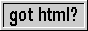

Welcome to my website

<br>

This is made using [markdown](https://www.markdownguide.org/) 

I like markdown as it is simple and removes boilerplate whilst not being too limiting.

<br>

## Buttons
[](https://www.mabsland.com/Adoption.html)
[](https://yesterweb.org/no-to-web3/)
[](http://toastytech.com/evil/)
[](http://www.theoldnet.com/#frombadge)
[](https://theonion.com)
[](https://store.steampowered.com)
[](https://www.firefox.com/)

<iframe src="//incr.easrng.net/badge?key=home-gihub.github.io" style="background: url(//incr.easrng.net/bg.gif)" title="increment badge" width="88" height="31" frameborder="0"></iframe>

<br>

|  | add my button to your site? |
| --- | ------- |
| Although I prefer buttons that actaully link to stuff, some of these are just images. |  <br> ```<a href="https://home-gihub.github.io"></a>```|


<p id="date" onclick="document.getElementById('date').textContent = `The date is: September ${Math.floor((Date.now() - Date.UTC(1993, 7, 31)) / (1000 * 3600 * 24))}, 1993`">Click to see the date in Eternal September format</p>

[What does this mean?](https://en.wikipedia.org/wiki/Eternal_September#Legacy)

## Things
[Creations](./creations.md)
> Webpages i have made

[Games](./games.md)
> Web ports, Flash, HTML5. All the games I have found.

## Webrings
[<- Previous](https://hotlinewebring.club/home-gihub/previous) | [The Hotline Webring](https://hotlinewebring.club/) | [Next ->](https://hotlinewebring.club/home-gihub/next)

[<- Previous](https://baccyflap.com/noai/?prv&s=hgh) | [The No AI Webring](https://baccyflap.com/noai) [( ∞ Random ∞ )](https://baccyflap.com/noai/?rnd) | [Next ->](https://baccyflap.com/noai/?nxt&s=hgh)
